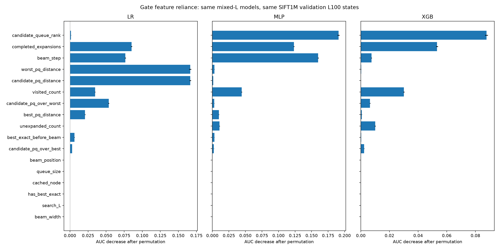

# 当前主模型的统一特征依赖分析

SIFT1M旧混合L权重，验证集基线L100未缓存状态。固定模型，未重训、未进行新在线搜索。Permutation及阈值指标均为代理retain标签指标，不是最终Recall或物理IO收益。

## 基准

|模型|AUC|Logloss|验证冻结阈值1%点实际FNR|
|---|---:|---:|---:|
| LR | 0.902923 | 0.371908 | 0.9986% |
| MLP | 0.912895 | 0.344498 | 0.9986% |
| XGB | 0.911648 | 0.346063 | 1.0012% |

## 单特征重要性

同一列、同一轮的随机排列在三模型之间完全一致。误差条是10次排列的标准差，不是置信区间。

### LR

|特征|AUC下降均值|排列SD|Logloss增加|
|---|---:|---:|---:|
|candidate_pq_distance|0.166404|0.001101|0.611328|
|worst_pq_distance|0.166360|0.001556|0.472220|
|completed_expansions|0.085231|0.000785|0.121651|
|beam_step|0.076643|0.000832|0.109320|
|candidate_pq_over_worst|0.053595|0.000752|0.110519|
|visited_count|0.034729|0.000459|0.152694|
|best_pq_distance|0.020887|0.000374|0.038170|
|best_exact_before_beam|0.006226|0.000169|0.012615|
|candidate_pq_over_best|0.003076|0.000043|0.005521|
|candidate_queue_rank|0.001456|0.000133|0.002558|
|unexpanded_count|0.000004|0.000057|0.000312|
|queue_size|0.000000|0.000000|0.000000|
|cached_node|0.000000|0.000000|0.000000|
|has_best_exact|0.000000|0.000000|0.000000|
|search_L|0.000000|0.000000|0.000000|
|beam_width|0.000000|0.000000|0.000000|
|beam_position|-0.000003|0.000035|0.000051|

### MLP

|特征|AUC下降均值|排列SD|Logloss增加|
|---|---:|---:|---:|
|candidate_queue_rank|0.190691|0.001505|0.282360|
|beam_step|0.159928|0.000761|0.241245|
|completed_expansions|0.123361|0.000589|0.198434|
|visited_count|0.044355|0.000572|0.232806|
|unexpanded_count|0.010907|0.000411|0.023365|
|best_pq_distance|0.009909|0.000240|0.022217|
|worst_pq_distance|0.003299|0.000200|0.007060|
|best_exact_before_beam|0.003147|0.000162|0.008214|
|candidate_pq_over_worst|0.002955|0.000114|0.011014|
|candidate_pq_over_best|0.002401|0.000072|0.005578|
|candidate_pq_distance|0.001383|0.000082|0.004122|
|beam_position|0.000203|0.000020|0.000456|
|queue_size|0.000000|0.000000|0.000000|
|cached_node|0.000000|0.000000|0.000000|
|has_best_exact|0.000000|0.000000|0.000000|
|search_L|0.000000|0.000000|0.000000|
|beam_width|0.000000|0.000000|0.000000|

### XGB

|特征|AUC下降均值|排列SD|Logloss增加|
|---|---:|---:|---:|
|candidate_queue_rank|0.087739|0.001031|0.158794|
|completed_expansions|0.053194|0.000732|0.078976|
|visited_count|0.030063|0.000459|0.081500|
|unexpanded_count|0.010019|0.000388|0.019669|
|beam_step|0.007495|0.000272|0.014302|
|candidate_pq_over_worst|0.006445|0.000202|0.013480|
|candidate_pq_over_best|0.002343|0.000121|0.003763|
|best_pq_distance|0.000711|0.000108|0.001275|
|best_exact_before_beam|0.000271|0.000046|0.000498|
|worst_pq_distance|0.000219|0.000046|0.000467|
|candidate_pq_distance|0.000049|0.000034|0.000081|
|beam_position|0.000018|0.000008|0.000030|
|queue_size|0.000000|0.000000|0.000000|
|cached_node|0.000000|0.000000|0.000000|
|has_best_exact|0.000000|0.000000|0.000000|
|search_L|0.000000|0.000000|0.000000|
|beam_width|0.000000|0.000000|0.000000|

## 解释边界

原先的XGB分析使用纯L100旧模型且观察过测试集；本次使用当前主实验的混合L权重和验证状态，不能把两次变化单独归因于解释方法。特征相关时，单列打乱可能产生不自然组合；组内联合打乱保留组内部关联，但仍破坏其与其他状态和标签的关系。重要性反映固定模型依赖，不证明因果关系、最优子集或删除重训后的性能。L/Beam及cache在本分析子集为常量，零重要性只适用于该切片。基线轨迹也不等于在线剪枝后的状态分布。对LR系数亦需考虑标准化和共线性。

完整组分析、冻结阈值变化与按query bootstrap区间见CSV。按query区间反映该组验证查询的采样变动，不包含训练种子不确定性。
