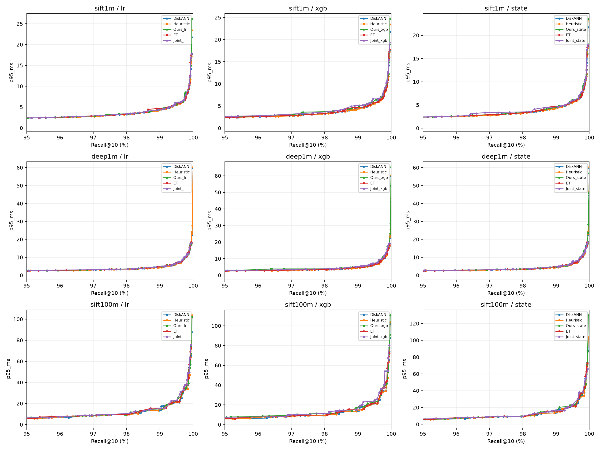
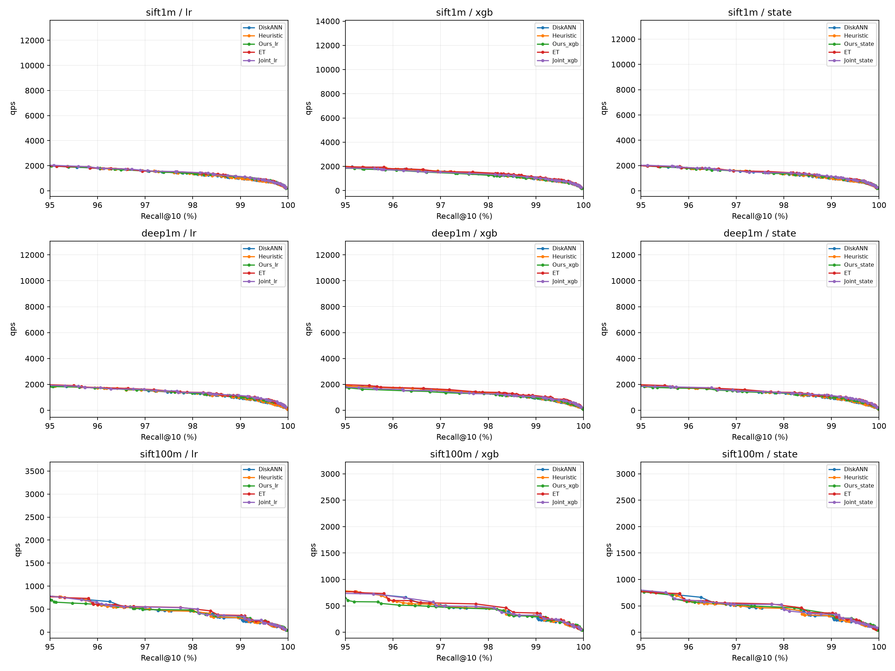
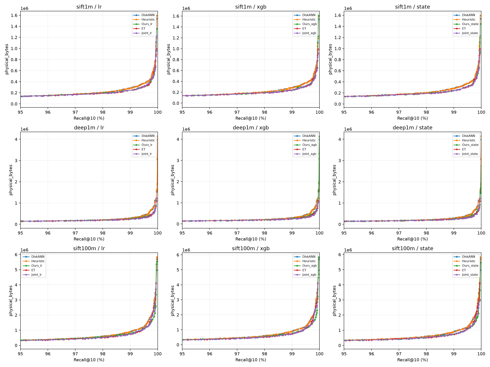

# 扩大搜索的旧模型补充实验

主表：仅用验证集选参，在新测试扫描前冻结。测试查询曾被历史实验观察过，不是全新盲测。严格匹配表：额外使用测试质量调参，属于描述性分析。两者分开报告。

每方法192个主实验候选（原64+新128）；L/阈值可调，环境/权重固定。P95、QPS和物理字节各自独立选择真实配置。严格匹配与未匹配分开，退化策略不冒充有效剪枝。

## sift1m

完整指标及所有目标见 `sift1m/validation_selected_test.csv` 和 `sift1m/strict_results.csv`。

### 验证Recall下限99.5%的选参结果

|目标%|方法|优化指标|L|测试Recall%|达标/严格匹配|P95ms|QPS|字节/Query|
|---:|---|---|---:|---:|---|---:|---:|---:|
| 99.5 | DiskANN | p95_ms | 85 | 99.43 | False | 5.425 | 793.9 | 358813.7 |
| 99.5 | DiskANN | qps | 85 | 99.43 | False | 5.425 | 793.9 | 358813.7 |
| 99.5 | DiskANN | physical_bytes | 83 | 99.39 | False | 5.309 | 803.4 | 350859.3 |
| 99.5 | Heuristic | p95_ms | 89 | 99.48 | False | 5.508 | 769.7 | 371290.1 |
| 99.5 | Heuristic | qps | 84 | 99.40 | False | 5.305 | 810.3 | 354975.7 |
| 99.5 | Heuristic | physical_bytes | 84 | 99.40 | False | 5.305 | 810.3 | 354975.7 |
| 99.5 | Ours_lr | p95_ms | 90 | 99.51 | True | 5.662 | 758.6 | 376086.5 |
| 99.5 | Ours_lr | qps | 111 | 99.63 | True | 6.402 | 833.3 | 331092.0 |
| 99.5 | Ours_lr | physical_bytes | 100 | 99.58 | True | 5.971 | 844.0 | 328233.0 |
| 99.5 | Ours_xgb | p95_ms | 87 | 99.46 | False | 5.949 | 716.7 | 366809.1 |
| 99.5 | Ours_xgb | qps | 143 | 99.50 | True | 6.656 | 805.4 | 307294.2 |
| 99.5 | Ours_xgb | physical_bytes | 160 | 99.45 | False | 6.412 | 818.4 | 303480.8 |
| 99.5 | Ours_state | p95_ms | 82 | 99.38 | False | 5.273 | 812.1 | 346812.4 |
| 99.5 | Ours_state | qps | 244 | 99.40 | False | 5.938 | 879.2 | 299999.2 |
| 99.5 | Ours_state | physical_bytes | 160 | 99.42 | False | 6.078 | 900.6 | 298278.9 |
| 99.5 | ET | p95_ms | 88 | 99.46 | False | 5.636 | 764.3 | 370929.7 |
| 99.5 | ET | qps | 656 | 99.38 | False | 5.925 | 941.6 | 292474.9 |
| 99.5 | ET | physical_bytes | 656 | 99.38 | False | 5.925 | 941.6 | 292474.9 |
| 99.5 | Joint_lr | p95_ms | 83 | 99.39 | False | 5.313 | 815.9 | 344641.5 |
| 99.5 | Joint_lr | qps | 142 | 99.38 | False | 6.731 | 956.5 | 288403.5 |
| 99.5 | Joint_lr | physical_bytes | 142 | 99.38 | False | 6.731 | 956.5 | 288403.5 |
| 99.5 | Joint_xgb | p95_ms | 93 | 99.43 | False | 6.171 | 835.6 | 305643.5 |
| 99.5 | Joint_xgb | qps | 523 | 99.40 | False | 6.899 | 856.4 | 293097.5 |
| 99.5 | Joint_xgb | physical_bytes | 226 | 99.33 | False | 7.336 | 894.8 | 285704.2 |
| 99.5 | Joint_state | p95_ms | 82 | 99.37 | False | 5.337 | 810.9 | 339390.5 |
| 99.5 | Joint_state | qps | 430 | 99.34 | False | 5.549 | 901.3 | 296476.7 |
| 99.5 | Joint_state | physical_bytes | 430 | 99.34 | False | 5.549 | 901.3 | 296476.7 |

### 严格匹配结果

|目标%|方法|优化指标|L|测试Recall%|达标/严格匹配|P95ms|QPS|字节/Query|
|---:|---|---|---:|---:|---|---:|---:|---:|
| 98.01 | DiskANN | p95_ms | 47 | 98.01 | True | 3.304 | 1349.5 | 207417.3 |
| 98.01 | DiskANN | qps | 47 | 98.01 | True | 3.304 | 1349.5 | 207417.3 |
| 98.01 | DiskANN | physical_bytes | 47 | 98.01 | True | 3.304 | 1349.5 | 207417.3 |
| 98.01 | Heuristic | p95_ms | 50 | 98.01 | True | 3.312 | 1344.6 | 207417.3 |
| 98.01 | Heuristic | qps | 50 | 98.01 | True | 3.312 | 1344.6 | 207417.3 |
| 98.01 | Heuristic | physical_bytes | 47 | 98.01 | True | 3.279 | 1336.2 | 207274.0 |
| 98.01 | Ours_lr | p95_ms | 47 | 98.01 | True | 3.313 | 1338.0 | 205156.4 |
| 98.01 | Ours_lr | qps | 141 | 98.01 | True | 3.973 | 1322.5 | 199929.9 |
| 98.01 | Ours_lr | physical_bytes | 70 | 98.01 | True | 3.924 | 1381.5 | 195383.3 |
| 98.01 | Ours_xgb | p95_ms | 47 | 98.01 | True | 3.577 | 1258.7 | 204861.4 |
| 98.01 | Ours_xgb | qps | 47 | 98.01 | True | 3.577 | 1258.7 | 204861.4 |
| 98.01 | Ours_xgb | physical_bytes | 70 | 98.01 | True | 4.293 | 1276.4 | 191377.4 |
| 98.01 | Ours_state | p95_ms | 47 | 98.01 | True | 3.350 | 1331.1 | 205926.4 |
| 98.01 | Ours_state | qps | 70 | 98.01 | True | 4.006 | 1384.4 | 192438.3 |
| 98.01 | Ours_state | physical_bytes | 188 | 98.01 | True | 3.891 | 1324.8 | 191922.2 |
| 98.01 | ET | p95_ms | 47 | 98.01 | True | 3.367 | 1333.6 | 206356.5 |
| 98.01 | ET | qps | 188 | 98.01 | True | 4.339 | 1450.9 | 186892.3 |
| 98.01 | ET | physical_bytes | 188 | 98.01 | True | 4.339 | 1450.9 | 186892.3 |
| 98.01 | Joint_lr | p95_ms | 56 | 98.02 | False | 3.662 | 1359.6 | 197378.0 |
| 98.01 | Joint_lr | qps | 56 | 98.00 | False | 3.624 | 1368.0 | 196202.5 |
| 98.01 | Joint_lr | physical_bytes | 56 | 98.00 | False | 3.624 | 1368.0 | 196202.5 |
| 98.01 | Joint_xgb | p95_ms | 56 | 98.01 | True | 3.954 | 1257.5 | 196804.6 |
| 98.01 | Joint_xgb | qps | 56 | 98.01 | True | 3.954 | 1257.5 | 196804.6 |
| 98.01 | Joint_xgb | physical_bytes | 56 | 98.01 | True | 3.954 | 1257.5 | 196804.6 |
| 98.01 | Joint_state | p95_ms | 56 | 98.02 | False | 3.741 | 1346.5 | 196149.2 |
| 98.01 | Joint_state | qps | 56 | 98.02 | False | 3.741 | 1346.5 | 196149.2 |
| 98.01 | Joint_state | physical_bytes | 56 | 98.00 | False | 3.718 | 1357.8 | 195555.3 |
| 99.46 | DiskANN | p95_ms | 88 | 99.46 | True | 5.581 | 763.3 | 370929.7 |
| 99.46 | DiskANN | qps | 88 | 99.46 | True | 5.581 | 763.3 | 370929.7 |
| 99.46 | DiskANN | physical_bytes | 87 | 99.46 | True | 5.499 | 776.7 | 366809.1 |
| 99.46 | Heuristic | p95_ms | 264 | 99.46 | True | 5.423 | 787.5 | 355188.7 |
| 99.46 | Heuristic | qps | 264 | 99.46 | True | 5.423 | 787.5 | 355188.7 |
| 99.46 | Heuristic | physical_bytes | 264 | 99.46 | True | 5.423 | 787.5 | 355188.7 |
| 99.46 | Ours_lr | p95_ms | 88 | 99.46 | True | 5.588 | 769.6 | 363786.2 |
| 99.46 | Ours_lr | qps | 176 | 99.46 | True | 6.129 | 882.8 | 311353.3 |
| 99.46 | Ours_lr | physical_bytes | 176 | 99.46 | True | 6.129 | 882.8 | 311353.3 |
| 99.46 | Ours_xgb | p95_ms | 88 | 99.46 | True | 6.006 | 718.6 | 360337.4 |
| 99.46 | Ours_xgb | qps | 88 | 99.46 | True | 6.006 | 718.6 | 360337.4 |
| 99.46 | Ours_xgb | physical_bytes | 352 | 99.46 | True | 6.722 | 715.6 | 320290.8 |
| 99.46 | Ours_state | p95_ms | 88 | 99.46 | True | 5.689 | 752.3 | 369053.7 |
| 99.46 | Ours_state | qps | 132 | 99.46 | True | 6.319 | 871.6 | 308105.2 |
| 99.46 | Ours_state | physical_bytes | 352 | 99.46 | True | 5.990 | 845.9 | 304406.5 |
| 99.46 | ET | p95_ms | 88 | 99.46 | True | 5.622 | 790.6 | 353624.1 |
| 99.46 | ET | qps | 100 | 99.46 | True | 6.053 | 902.9 | 307576.8 |
| 99.46 | ET | physical_bytes | 176 | 99.46 | True | 7.210 | 883.5 | 307081.2 |
| 99.46 | Joint_lr | p95_ms | 106 | 99.46 | True | 6.104 | 888.2 | 304287.7 |
| 99.46 | Joint_lr | qps | 106 | 99.46 | True | 6.104 | 888.2 | 304287.7 |
| 99.46 | Joint_lr | physical_bytes | 106 | 99.46 | True | 6.104 | 888.2 | 304287.7 |
| 99.46 | Joint_xgb | p95_ms | 100 | 99.46 | True | 6.544 | 824.4 | 307499.0 |
| 99.46 | Joint_xgb | qps | 100 | 99.46 | True | 6.544 | 824.4 | 307499.0 |
| 99.46 | Joint_xgb | physical_bytes | 106 | 99.46 | True | 6.619 | 821.3 | 306909.2 |
| 99.46 | Joint_state | p95_ms | 106 | 99.46 | True | 6.217 | 879.5 | 303136.8 |
| 99.46 | Joint_state | qps | 100 | 99.46 | True | 6.152 | 878.4 | 307572.7 |
| 99.46 | Joint_state | physical_bytes | 106 | 99.46 | True | 6.229 | 887.7 | 302043.1 |
| 99.8 | DiskANN | p95_ms | 133 | 99.80 | True | 8.241 | 515.4 | 552284.2 |
| 99.8 | DiskANN | qps | 133 | 99.80 | True | 8.241 | 515.4 | 552284.2 |
| 99.8 | DiskANN | physical_bytes | 131 | 99.80 | True | 7.980 | 526.9 | 544210.9 |
| 99.8 | Heuristic | p95_ms | 133 | 99.80 | True | 8.007 | 528.2 | 540090.4 |
| 99.8 | Heuristic | qps | 133 | 99.80 | True | 8.007 | 528.2 | 540090.4 |
| 99.8 | Heuristic | physical_bytes | 133 | 99.80 | True | 8.007 | 528.2 | 540090.4 |
| 99.8 | Ours_lr | p95_ms | 133 | 99.80 | True | 8.081 | 533.7 | 531103.7 |
| 99.8 | Ours_lr | qps | 160 | 99.80 | True | 8.891 | 613.5 | 447803.4 |
| 99.8 | Ours_lr | physical_bytes | 160 | 99.80 | True | 8.891 | 613.5 | 447803.4 |
| 99.8 | Ours_xgb | p95_ms | 133 | 99.80 | True | 8.731 | 491.3 | 536002.6 |
| 99.8 | Ours_xgb | qps | 200 | 99.80 | True | 9.524 | 572.7 | 438939.6 |
| 99.8 | Ours_xgb | physical_bytes | 160 | 99.80 | True | 9.395 | 594.7 | 423944.2 |
| 99.8 | Ours_state | p95_ms | 266 | 99.80 | True | 8.220 | 635.8 | 419397.6 |
| 99.8 | Ours_state | qps | 160 | 99.80 | True | 8.731 | 640.9 | 418836.5 |
| 99.8 | Ours_state | physical_bytes | 200 | 99.80 | True | 8.582 | 645.1 | 414474.2 |
| 99.8 | ET | p95_ms | 133 | 99.80 | True | 8.194 | 539.9 | 521142.3 |
| 99.8 | ET | qps | 200 | 99.80 | True | 9.647 | 606.0 | 452005.9 |
| 99.8 | ET | physical_bytes | 200 | 99.80 | True | 9.647 | 606.0 | 452005.9 |
| 99.8 | Joint_lr | p95_ms | 160 | 99.80 | True | 9.219 | 595.0 | 460283.9 |
| 99.8 | Joint_lr | qps | 160 | 99.80 | True | 9.219 | 595.0 | 460283.9 |
| 99.8 | Joint_lr | physical_bytes | 160 | 99.80 | True | 9.147 | 596.2 | 457285.6 |
| 99.8 | Joint_xgb | p95_ms | 142 | 99.80 | True | 9.048 | 578.2 | 436060.2 |
| 99.8 | Joint_xgb | qps | 160 | 99.80 | True | 9.751 | 580.4 | 433975.3 |
| 99.8 | Joint_xgb | physical_bytes | 160 | 99.80 | True | 9.751 | 580.4 | 433975.3 |
| 99.8 | Joint_state | p95_ms | 200 | 99.80 | True | 8.680 | 640.1 | 414474.2 |
| 99.8 | Joint_state | qps | 200 | 99.80 | True | 8.680 | 640.1 | 414474.2 |
| 99.8 | Joint_state | physical_bytes | 200 | 99.80 | True | 8.680 | 640.1 | 414474.2 |

## deep1m

完整指标及所有目标见 `deep1m/validation_selected_test.csv` 和 `deep1m/strict_results.csv`。

### 验证Recall下限99.5%的选参结果

|目标%|方法|优化指标|L|测试Recall%|达标/严格匹配|P95ms|QPS|字节/Query|
|---:|---|---|---:|---:|---|---:|---:|---:|
| 99.5 | DiskANN | p95_ms | 99 | 99.47 | False | 6.479 | 674.0 | 414588.9 |
| 99.5 | DiskANN | qps | 99 | 99.47 | False | 6.479 | 674.0 | 414588.9 |
| 99.5 | DiskANN | physical_bytes | 99 | 99.47 | False | 6.479 | 674.0 | 414588.9 |
| 99.5 | Heuristic | p95_ms | 111 | 99.48 | False | 6.378 | 664.6 | 422092.8 |
| 99.5 | Heuristic | qps | 111 | 99.48 | False | 6.378 | 664.6 | 422092.8 |
| 99.5 | Heuristic | physical_bytes | 104 | 99.47 | False | 6.452 | 670.7 | 410591.2 |
| 99.5 | Ours_lr | p95_ms | 110 | 99.54 | True | 7.033 | 638.6 | 431833.1 |
| 99.5 | Ours_lr | qps | 194 | 99.52 | True | 7.929 | 773.9 | 349376.5 |
| 99.5 | Ours_lr | physical_bytes | 194 | 99.52 | True | 7.929 | 773.9 | 349376.5 |
| 99.5 | Ours_xgb | p95_ms | 101 | 99.48 | False | 7.157 | 603.6 | 420200.4 |
| 99.5 | Ours_xgb | qps | 139 | 99.55 | True | 8.768 | 694.5 | 352825.3 |
| 99.5 | Ours_xgb | physical_bytes | 139 | 99.55 | True | 8.768 | 694.5 | 352825.3 |
| 99.5 | Ours_state | p95_ms | 103 | 99.44 | False | 6.777 | 650.1 | 414892.0 |
| 99.5 | Ours_state | qps | 128 | 99.47 | False | 7.731 | 771.3 | 336646.1 |
| 99.5 | Ours_state | physical_bytes | 216 | 99.50 | True | 7.972 | 763.7 | 336478.2 |
| 99.5 | ET | p95_ms | 102 | 99.48 | False | 6.782 | 637.6 | 426287.1 |
| 99.5 | ET | qps | 141 | 99.52 | True | 7.979 | 828.8 | 321593.3 |
| 99.5 | ET | physical_bytes | 141 | 99.52 | True | 7.979 | 828.8 | 321593.3 |
| 99.5 | Joint_lr | p95_ms | 105 | 99.47 | False | 6.609 | 722.6 | 376807.4 |
| 99.5 | Joint_lr | qps | 188 | 99.55 | True | 8.369 | 836.0 | 322940.9 |
| 99.5 | Joint_lr | physical_bytes | 298 | 99.54 | True | 8.785 | 843.7 | 314794.0 |
| 99.5 | Joint_xgb | p95_ms | 108 | 99.56 | True | 7.585 | 568.3 | 450297.9 |
| 99.5 | Joint_xgb | qps | 523 | 99.57 | True | 9.446 | 741.4 | 327528.4 |
| 99.5 | Joint_xgb | physical_bytes | 523 | 99.57 | True | 9.446 | 741.4 | 327528.4 |
| 99.5 | Joint_state | p95_ms | 571 | 99.50 | True | 7.353 | 733.1 | 347779.1 |
| 99.5 | Joint_state | qps | 156 | 99.51 | True | 7.852 | 852.6 | 310231.0 |
| 99.5 | Joint_state | physical_bytes | 156 | 99.51 | True | 7.852 | 852.6 | 310231.0 |

### 严格匹配结果

|目标%|方法|优化指标|L|测试Recall%|达标/严格匹配|P95ms|QPS|字节/Query|
|---:|---|---|---:|---:|---|---:|---:|---:|
| 98.04 | DiskANN | p95_ms | 47 | 98.04 | True | 4.079 | 1105.8 | 208740.4 |
| 98.04 | DiskANN | qps | 47 | 98.04 | True | 4.079 | 1105.8 | 208740.4 |
| 98.04 | DiskANN | physical_bytes | 47 | 98.04 | True | 4.079 | 1105.8 | 208740.4 |
| 98.04 | Heuristic | p95_ms | 47 | 98.03 | False | 4.121 | 1088.7 | 208027.6 |
| 98.04 | Heuristic | qps | 50 | 98.05 | False | 4.122 | 1099.9 | 208797.7 |
| 98.04 | Heuristic | physical_bytes | 47 | 98.03 | False | 4.121 | 1088.7 | 208027.6 |
| 98.04 | Ours_lr | p95_ms | 47 | 98.04 | True | 4.106 | 1098.3 | 208404.5 |
| 98.04 | Ours_lr | qps | 47 | 98.04 | True | 4.106 | 1098.3 | 208404.5 |
| 98.04 | Ours_lr | physical_bytes | 94 | 98.04 | True | 5.442 | 1097.7 | 202244.1 |
| 98.04 | Ours_xgb | p95_ms | 47 | 98.04 | True | 4.615 | 987.0 | 207278.1 |
| 98.04 | Ours_xgb | qps | 47 | 98.04 | True | 4.615 | 987.0 | 207278.1 |
| 98.04 | Ours_xgb | physical_bytes | 188 | 98.04 | True | 5.777 | 910.4 | 194351.1 |
| 98.04 | Ours_state | p95_ms | 47 | 98.04 | True | 4.224 | 1077.6 | 207327.2 |
| 98.04 | Ours_state | qps | 47 | 98.04 | True | 4.268 | 1074.8 | 207900.7 |
| 98.04 | Ours_state | physical_bytes | 188 | 98.04 | True | 5.146 | 1056.6 | 197443.6 |
| 98.04 | ET | p95_ms | 47 | 98.04 | True | 4.158 | 1087.9 | 207360.0 |
| 98.04 | ET | qps | 70 | 98.04 | True | 5.059 | 1205.8 | 189231.1 |
| 98.04 | ET | physical_bytes | 70 | 98.04 | True | 5.059 | 1205.8 | 189231.1 |
| 98.04 | Joint_lr | p95_ms | 188 | 98.04 | True | 6.308 | 1140.3 | 195534.8 |
| 98.04 | Joint_lr | qps | 188 | 98.04 | True | 6.308 | 1140.3 | 195534.8 |
| 98.04 | Joint_lr | physical_bytes | 188 | 98.04 | True | 6.308 | 1140.3 | 195534.8 |
| 98.04 | Joint_xgb | p95_ms | 56 | 98.03 | False | 5.118 | 1007.6 | 197414.9 |
| 98.04 | Joint_xgb | qps | 188 | 98.05 | False | 7.004 | 1039.7 | 195473.4 |
| 98.04 | Joint_xgb | physical_bytes | 188 | 98.05 | False | 7.004 | 1039.7 | 195473.4 |
| 98.04 | Joint_state | p95_ms | 56 | 98.03 | False | 4.752 | 1086.9 | 198819.8 |
| 98.04 | Joint_state | qps | 56 | 98.03 | False | 4.634 | 1102.1 | 199348.2 |
| 98.04 | Joint_state | physical_bytes | 56 | 98.03 | False | 4.752 | 1086.9 | 198819.8 |
| 99.51 | DiskANN | p95_ms | 104 | 99.51 | True | 7.921 | 538.8 | 434438.1 |
| 99.51 | DiskANN | qps | 104 | 99.51 | True | 7.921 | 538.8 | 434438.1 |
| 99.51 | DiskANN | physical_bytes | 104 | 99.51 | True | 7.921 | 538.8 | 434438.1 |
| 99.51 | Heuristic | p95_ms | 312 | 99.51 | True | 7.949 | 541.9 | 422912.0 |
| 99.51 | Heuristic | qps | 312 | 99.51 | True | 7.949 | 541.9 | 422912.0 |
| 99.51 | Heuristic | physical_bytes | 312 | 99.51 | True | 7.949 | 541.9 | 422912.0 |
| 99.51 | Ours_lr | p95_ms | 104 | 99.51 | True | 7.870 | 542.7 | 431202.3 |
| 99.51 | Ours_lr | qps | 156 | 99.51 | True | 9.686 | 654.6 | 351539.2 |
| 99.51 | Ours_lr | physical_bytes | 208 | 99.51 | True | 9.434 | 642.1 | 345403.4 |
| 99.51 | Ours_xgb | p95_ms | 104 | 99.51 | True | 8.747 | 493.0 | 429088.8 |
| 99.51 | Ours_xgb | qps | 125 | 99.51 | True | 9.823 | 585.5 | 343265.3 |
| 99.51 | Ours_xgb | physical_bytes | 208 | 99.51 | True | 10.352 | 570.3 | 334868.5 |
| 99.51 | Ours_state | p95_ms | 104 | 99.51 | True | 8.159 | 530.3 | 433684.5 |
| 99.51 | Ours_state | qps | 208 | 99.51 | True | 9.581 | 640.3 | 340529.2 |
| 99.51 | Ours_state | physical_bytes | 208 | 99.51 | True | 9.513 | 641.1 | 339742.7 |
| 99.51 | ET | p95_ms | 104 | 99.51 | True | 7.936 | 547.5 | 425349.1 |
| 99.51 | ET | qps | 312 | 99.51 | True | 10.045 | 733.0 | 306782.2 |
| 99.51 | ET | physical_bytes | 312 | 99.51 | True | 10.045 | 733.0 | 306782.2 |
| 99.51 | Joint_lr | p95_ms | 156 | 99.51 | True | 9.877 | 639.5 | 349937.7 |
| 99.51 | Joint_lr | qps | 156 | 99.51 | True | 9.877 | 639.5 | 349937.7 |
| 99.51 | Joint_lr | physical_bytes | 156 | 99.51 | True | 9.877 | 639.5 | 349937.7 |
| 99.51 | Joint_xgb | p95_ms | 125 | 99.51 | True | 9.998 | 582.5 | 344551.4 |
| 99.51 | Joint_xgb | qps | 125 | 99.51 | True | 9.990 | 586.9 | 342216.7 |
| 99.51 | Joint_xgb | physical_bytes | 125 | 99.51 | True | 9.990 | 586.9 | 342216.7 |
| 99.51 | Joint_state | p95_ms | 125 | 99.51 | True | 8.997 | 640.9 | 344121.3 |
| 99.51 | Joint_state | qps | 125 | 99.51 | True | 8.997 | 640.9 | 344121.3 |
| 99.51 | Joint_state | physical_bytes | 125 | 99.51 | True | 8.997 | 640.9 | 344121.3 |
| 99.8 | DiskANN | p95_ms | 172 | 99.80 | True | 12.651 | 333.4 | 706744.3 |
| 99.8 | DiskANN | qps | 172 | 99.80 | True | 12.651 | 333.4 | 706744.3 |
| 99.8 | DiskANN | physical_bytes | 172 | 99.80 | True | 12.651 | 333.4 | 706744.3 |
| 99.8 | Heuristic | p95_ms | 206 | 99.80 | True | 12.875 | 331.9 | 706814.0 |
| 99.8 | Heuristic | qps | 206 | 99.80 | True | 12.875 | 331.9 | 706814.0 |
| 99.8 | Heuristic | physical_bytes | 516 | 99.80 | True | 12.299 | 342.9 | 674115.6 |
| 99.8 | Ours_lr | p95_ms | 287 | 99.80 | True | 13.250 | 461.7 | 489492.5 |
| 99.8 | Ours_lr | qps | 287 | 99.80 | True | 13.250 | 461.7 | 489492.5 |
| 99.8 | Ours_lr | physical_bytes | 688 | 99.80 | True | 12.651 | 452.0 | 477966.3 |
| 99.8 | Ours_xgb | p95_ms | 343 | 99.80 | True | 15.313 | 352.8 | 560971.8 |
| 99.8 | Ours_xgb | qps | 343 | 99.80 | True | 15.313 | 352.8 | 560971.8 |
| 99.8 | Ours_xgb | physical_bytes | 258 | 99.80 | True | 14.828 | 387.3 | 505659.4 |
| 99.8 | Ours_state | p95_ms | 516 | 99.80 | True | 13.731 | 416.8 | 511283.2 |
| 99.8 | Ours_state | qps | 258 | 99.80 | True | 14.676 | 424.1 | 514506.8 |
| 99.8 | Ours_state | physical_bytes | 206 | 99.80 | True | 14.296 | 437.3 | 509329.4 |
| 99.8 | ET | p95_ms | 172 | 99.80 | True | 12.792 | 327.3 | 706609.2 |
| 99.8 | ET | qps | 258 | 99.80 | True | 13.448 | 496.4 | 464392.2 |
| 99.8 | ET | physical_bytes | 258 | 99.80 | True | 13.448 | 496.4 | 464392.2 |
| 99.8 | Joint_lr | p95_ms | 258 | 99.80 | True | 13.511 | 456.9 | 492027.9 |
| 99.8 | Joint_lr | qps | 206 | 99.80 | True | 13.333 | 484.7 | 469221.4 |
| 99.8 | Joint_lr | physical_bytes | 206 | 99.80 | True | 13.333 | 484.7 | 469221.4 |
| 99.8 | Joint_xgb | p95_ms | 206 | 99.80 | True | 14.970 | 427.5 | 479289.3 |
| 99.8 | Joint_xgb | qps | 206 | 99.80 | True | 14.970 | 427.5 | 479289.3 |
| 99.8 | Joint_xgb | physical_bytes | 206 | 99.80 | True | 14.612 | 432.9 | 475975.7 |
| 99.8 | Joint_state | p95_ms | 184 | 99.80 | True | 13.168 | 398.4 | 570474.5 |
| 99.8 | Joint_state | qps | 184 | 99.80 | True | 13.168 | 398.4 | 570474.5 |
| 99.8 | Joint_state | physical_bytes | 206 | 99.80 | True | 13.931 | 465.7 | 478040.1 |

## sift100m

完整指标及所有目标见 `sift100m/validation_selected_test.csv` 和 `sift100m/strict_results.csv`。

### 验证Recall下限99.5%的选参结果

|目标%|方法|优化指标|L|测试Recall%|达标/严格匹配|P95ms|QPS|字节/Query|
|---:|---|---|---:|---:|---|---:|---:|---:|
| 99.5 | DiskANN | p95_ms | 400 | 99.66 | True | 25.193 | 167.3 | 1670529.0 |
| 99.5 | DiskANN | qps | 400 | 99.66 | True | 25.193 | 167.3 | 1670529.0 |
| 99.5 | DiskANN | physical_bytes | 330 | 99.58 | True | 21.084 | 200.1 | 1385332.7 |
| 99.5 | Heuristic | p95_ms | 404 | 99.58 | True | 21.519 | 195.7 | 1409777.7 |
| 99.5 | Heuristic | qps | 404 | 99.58 | True | 21.519 | 195.7 | 1409777.7 |
| 99.5 | Heuristic | physical_bytes | 420 | 99.58 | True | 21.226 | 199.0 | 1389441.0 |
| 99.5 | Ours_lr | p95_ms | 553 | 99.54 | True | 25.072 | 233.7 | 1154351.1 |
| 99.5 | Ours_lr | qps | 553 | 99.54 | True | 25.072 | 233.7 | 1154351.1 |
| 99.5 | Ours_lr | physical_bytes | 500 | 99.52 | True | 23.877 | 245.2 | 1109807.1 |
| 99.5 | Ours_xgb | p95_ms | 343 | 99.60 | True | 23.605 | 178.2 | 1438195.7 |
| 99.5 | Ours_xgb | qps | 479 | 99.69 | True | 30.612 | 183.3 | 1368346.6 |
| 99.5 | Ours_xgb | physical_bytes | 341 | 99.49 | False | 22.792 | 225.5 | 1115185.2 |
| 99.5 | Ours_state | p95_ms | 398 | 99.61 | True | 24.990 | 208.9 | 1269145.6 |
| 99.5 | Ours_state | qps | 398 | 99.61 | True | 24.990 | 208.9 | 1269145.6 |
| 99.5 | Ours_state | physical_bytes | 396 | 99.42 | False | 22.816 | 265.9 | 991399.9 |
| 99.5 | ET | p95_ms | 341 | 99.59 | True | 21.947 | 190.3 | 1429127.2 |
| 99.5 | ET | qps | 500 | 99.58 | True | 27.704 | 219.5 | 1237237.8 |
| 99.5 | ET | physical_bytes | 348 | 99.52 | True | 21.717 | 239.7 | 1134776.3 |
| 99.5 | Joint_lr | p95_ms | 1090 | 99.44 | False | 23.455 | 260.5 | 1011408.9 |
| 99.5 | Joint_lr | qps | 1090 | 99.44 | False | 23.455 | 260.5 | 1011408.9 |
| 99.5 | Joint_lr | physical_bytes | 1090 | 99.44 | False | 23.455 | 260.5 | 1011408.9 |
| 99.5 | Joint_xgb | p95_ms | 383 | 99.58 | True | 25.866 | 196.5 | 1296564.2 |
| 99.5 | Joint_xgb | qps | 352 | 99.48 | False | 23.716 | 234.5 | 1076690.9 |
| 99.5 | Joint_xgb | physical_bytes | 435 | 99.42 | False | 25.887 | 245.5 | 1018306.6 |
| 99.5 | Joint_state | p95_ms | 1184 | 99.41 | False | 23.357 | 260.3 | 993931.3 |
| 99.5 | Joint_state | qps | 1184 | 99.41 | False | 23.357 | 260.3 | 993931.3 |
| 99.5 | Joint_state | physical_bytes | 1184 | 99.41 | False | 23.357 | 260.3 | 993931.3 |

### 严格匹配结果

|目标%|方法|优化指标|L|测试Recall%|达标/严格匹配|P95ms|QPS|字节/Query|
|---:|---|---|---:|---:|---|---:|---:|---:|
| 98.0 | DiskANN | p95_ms | 136 | 98.00 | True | 16.167 | 297.0 | 598216.7 |
| 98.0 | DiskANN | qps | 136 | 98.00 | True | 16.167 | 297.0 | 598216.7 |
| 98.0 | DiskANN | physical_bytes | 136 | 98.00 | True | 16.167 | 297.0 | 598216.7 |
| 98.0 | Heuristic | p95_ms | 160 | 98.00 | True | 16.114 | 297.3 | 589054.0 |
| 98.0 | Heuristic | qps | 160 | 98.00 | True | 16.114 | 297.3 | 589054.0 |
| 98.0 | Heuristic | physical_bytes | 160 | 98.00 | True | 16.114 | 297.3 | 589054.0 |
| 98.0 | Ours_lr | p95_ms | 136 | 98.00 | True | 16.855 | 289.1 | 593723.4 |
| 98.0 | Ours_lr | qps | 204 | 98.00 | True | 18.020 | 317.4 | 549560.3 |
| 98.0 | Ours_lr | physical_bytes | 204 | 98.00 | True | 18.020 | 317.4 | 549560.3 |
| 98.0 | Ours_xgb | p95_ms | 136 | 98.00 | True | 17.595 | 290.1 | 569200.6 |
| 98.0 | Ours_xgb | qps | 163 | 98.00 | True | 20.800 | 277.1 | 524054.5 |
| 98.0 | Ours_xgb | physical_bytes | 204 | 98.00 | True | 23.898 | 253.8 | 523006.0 |
| 98.0 | Ours_state | p95_ms | 544 | 98.00 | True | 17.174 | 301.5 | 519274.5 |
| 98.0 | Ours_state | qps | 544 | 98.00 | True | 17.174 | 301.5 | 519274.5 |
| 98.0 | Ours_state | physical_bytes | 204 | 98.00 | True | 17.444 | 329.8 | 502362.1 |
| 98.0 | ET | p95_ms | 136 | 98.00 | True | 16.408 | 300.4 | 576311.3 |
| 98.0 | ET | qps | 163 | 98.00 | True | 18.797 | 323.2 | 518770.7 |
| 98.0 | ET | physical_bytes | 163 | 98.00 | True | 16.951 | 346.8 | 516423.7 |
| 98.0 | Joint_lr | p95_ms | 163 | 97.99 | False | 17.369 | 318.5 | 545939.5 |
| 98.0 | Joint_lr | qps | 163 | 97.99 | False | 17.369 | 318.5 | 545939.5 |
| 98.0 | Joint_lr | physical_bytes | 163 | 97.99 | False | 17.846 | 307.4 | 544739.3 |
| 98.0 | Joint_xgb | p95_ms | 163 | 98.00 | True | 20.728 | 275.8 | 524034.0 |
| 98.0 | Joint_xgb | qps | 163 | 98.00 | True | 20.728 | 275.8 | 524034.0 |
| 98.0 | Joint_xgb | physical_bytes | 163 | 98.00 | True | 20.728 | 275.8 | 524034.0 |
| 98.0 | Joint_state | p95_ms | 163 | 98.00 | True | 15.792 | 345.5 | 515743.7 |
| 98.0 | Joint_state | qps | 163 | 98.00 | True | 15.792 | 345.5 | 515743.7 |
| 98.0 | Joint_state | physical_bytes | 163 | 98.00 | True | 15.792 | 345.5 | 515743.7 |
| 99.51 | DiskANN | p95_ms | 293 | 99.51 | True | 36.309 | 148.5 | 1234845.7 |
| 99.51 | DiskANN | qps | 293 | 99.51 | True | 36.309 | 148.5 | 1234845.7 |
| 99.51 | DiskANN | physical_bytes | 293 | 99.51 | True | 36.309 | 148.5 | 1234845.7 |
| 99.51 | Heuristic | p95_ms | 300 | 99.51 | True | 31.754 | 148.8 | 1243017.2 |
| 99.51 | Heuristic | qps | 304 | 99.51 | True | 32.015 | 149.3 | 1234849.8 |
| 99.51 | Heuristic | physical_bytes | 293 | 99.51 | True | 31.684 | 153.4 | 1218482.2 |
| 99.51 | Ours_lr | p95_ms | 293 | 99.51 | True | 32.481 | 148.6 | 1220485.1 |
| 99.51 | Ours_lr | qps | 586 | 99.51 | True | 38.106 | 157.8 | 1122844.7 |
| 99.51 | Ours_lr | physical_bytes | 440 | 99.51 | True | 36.958 | 163.0 | 1093918.7 |
| 99.51 | Ours_xgb | p95_ms | 300 | 99.51 | True | 36.749 | 140.6 | 1150672.9 |
| 99.51 | Ours_xgb | qps | 300 | 99.51 | True | 36.749 | 140.6 | 1150672.9 |
| 99.51 | Ours_xgb | physical_bytes | 879 | 99.51 | True | 46.690 | 121.7 | 1075363.8 |
| 99.51 | Ours_state | p95_ms | 300 | 99.51 | True | 32.989 | 150.9 | 1169997.8 |
| 99.51 | Ours_state | qps | 300 | 99.51 | True | 32.989 | 150.9 | 1169997.8 |
| 99.51 | Ours_state | physical_bytes | 879 | 99.51 | True | 36.658 | 153.8 | 1074032.6 |
| 99.51 | ET | p95_ms | 305 | 99.51 | True | 33.554 | 140.9 | 1277358.1 |
| 99.51 | ET | qps | 305 | 99.51 | True | 33.554 | 140.9 | 1277358.1 |
| 99.51 | ET | physical_bytes | 879 | 99.51 | True | 41.412 | 157.1 | 1086140.4 |
| 99.51 | Joint_lr | p95_ms | 352 | 99.51 | True | 34.152 | 162.5 | 1127841.8 |
| 99.51 | Joint_lr | qps | 352 | 99.51 | True | 34.152 | 162.5 | 1127841.8 |
| 99.51 | Joint_lr | physical_bytes | 440 | 99.51 | True | 36.706 | 161.9 | 1115119.6 |
| 99.51 | Joint_xgb | p95_ms | 352 | 99.51 | True | 45.626 | 129.7 | 1138651.1 |
| 99.51 | Joint_xgb | qps | 352 | 99.51 | True | 45.626 | 129.7 | 1138651.1 |
| 99.51 | Joint_xgb | physical_bytes | 352 | 99.51 | True | 51.002 | 117.6 | 1129775.1 |
| 99.51 | Joint_state | p95_ms | 352 | 99.51 | True | 36.279 | 153.4 | 1129111.6 |
| 99.51 | Joint_state | qps | 352 | 99.51 | True | 36.279 | 153.4 | 1129111.6 |
| 99.51 | Joint_state | physical_bytes | 352 | 99.51 | True | 34.721 | 156.6 | 1122590.7 |
| 99.8 | DiskANN | p95_ms | 500 | 99.80 | True | 52.799 | 89.5 | 2078392.3 |
| 99.8 | DiskANN | qps | 500 | 99.80 | True | 52.799 | 89.5 | 2078392.3 |
| 99.8 | DiskANN | physical_bytes | 498 | 99.80 | True | 54.809 | 89.1 | 2070204.4 |
| 99.8 | Heuristic | p95_ms | 500 | 99.80 | True | 50.792 | 92.9 | 2029187.1 |
| 99.8 | Heuristic | qps | 1000 | 99.80 | True | 55.221 | 90.0 | 2028535.8 |
| 99.8 | Heuristic | physical_bytes | 1500 | 99.80 | True | 51.111 | 90.8 | 2028433.4 |
| 99.8 | Ours_lr | p95_ms | 500 | 99.80 | True | 47.463 | 109.4 | 1674928.1 |
| 99.8 | Ours_lr | qps | 600 | 99.80 | True | 52.177 | 111.7 | 1616928.8 |
| 99.8 | Ours_lr | physical_bytes | 600 | 99.80 | True | 52.177 | 111.7 | 1616928.8 |
| 99.8 | Ours_xgb | p95_ms | 492 | 99.80 | True | 65.603 | 82.2 | 1942782.0 |
| 99.8 | Ours_xgb | qps | 500 | 99.80 | True | 57.313 | 94.9 | 1695666.2 |
| 99.8 | Ours_xgb | physical_bytes | 600 | 99.80 | True | 62.556 | 96.0 | 1545990.1 |
| 99.8 | Ours_state | p95_ms | 720 | 99.80 | True | 59.290 | 101.9 | 1630031.9 |
| 99.8 | Ours_state | qps | 720 | 99.80 | True | 59.290 | 101.9 | 1630031.9 |
| 99.8 | Ours_state | physical_bytes | 600 | 99.80 | True | 60.552 | 102.2 | 1604255.7 |
| 99.8 | ET | p95_ms | 500 | 99.80 | True | 60.182 | 85.8 | 2077675.5 |
| 99.8 | ET | qps | 500 | 99.80 | True | 60.182 | 85.8 | 2077675.5 |
| 99.8 | ET | physical_bytes | 500 | 99.80 | True | 60.182 | 85.8 | 2077675.5 |
| 99.8 | Joint_lr | p95_ms | 1715 | 99.80 | True | 66.821 | 86.2 | 2020532.2 |
| 99.8 | Joint_lr | qps | 1715 | 99.80 | True | 66.821 | 86.2 | 2020532.2 |
| 99.8 | Joint_lr | physical_bytes | 750 | 99.80 | True | 62.190 | 99.6 | 1753243.6 |
| 99.8 | Joint_xgb | p95_ms | 750 | 99.80 | True | 67.196 | 87.7 | 1775792.1 |
| 99.8 | Joint_xgb | qps | 750 | 99.80 | True | 67.196 | 87.7 | 1775792.1 |
| 99.8 | Joint_xgb | physical_bytes | 750 | 99.80 | True | 67.196 | 87.7 | 1775792.1 |
| 99.8 | Joint_state | p95_ms | 1612 | 99.80 | True | 65.926 | 85.0 | 2013569.0 |
| 99.8 | Joint_state | qps | 1612 | 99.80 | True | 65.926 | 85.0 | 2013569.0 |
| 99.8 | Joint_state | physical_bytes | 750 | 99.80 | True | 63.945 | 94.3 | 1808474.1 |

